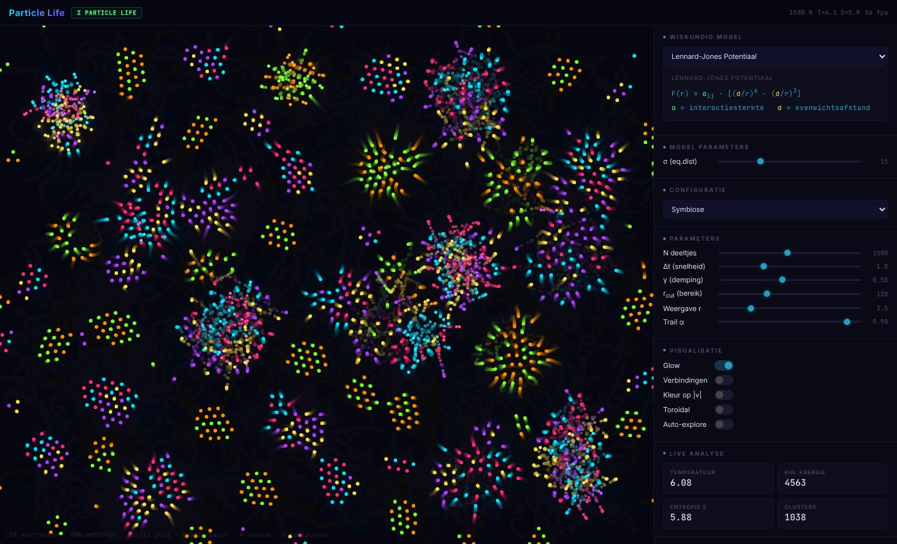

# Particle Life

Een simulatie waarin duizenden gekleurde deeltjes elkaar aantrekken of afstoten.
Uit een paar simpele regels ontstaan vanzelf patronen die op cellen, zwermen of
sterrenstelsels lijken. Niets daarvan is geprogrammeerd: het *ontstaat*.

**[▶ Probeer het live](https://stardust-21.github.io/Particle_Life/)** · gemaakt door [StΔrDüst21](https://github.com/StarDust-21)

---

## Wat is het?

Er zijn 6 soorten deeltjes (kleuren). Voor elk paar kleuren staat in een tabel,
de **interactiematrix**, een getal tussen −1 en +1:

- **positief** → de ene kleur wordt aangetrokken door de andere
- **negatief** → de ene kleur wordt afgestoten door de andere

De matrix hoeft niet symmetrisch te zijn: cyaan kan roze achtervolgen terwijl roze
voor cyaan vlucht. Juist daardoor ontstaan bewegende "organismen".

## Hoe werkt het?

Elk frame (60 keer per seconde) gebeurt dit voor elk deeltje:

1. **Buren zoeken** – alleen deeltjes binnen een bepaald bereik (rcut) tellen mee.
2. **Kracht optellen** – per buur wordt een kracht berekend met het gekozen model.
3. **Snelheid bijwerken** – `v(t+1) = v(t) · γ + F · Δt` (γ = demping, een soort wrijving).
4. **Positie bijwerken** – het deeltje schuift op met zijn snelheid.

### Zes natuurkundige modellen

| Model | Formule | Gedrag |
|---|---|---|
| Lennard-Jones | `F = α · [(σ/r)⁶ − (σ/r)³]` | sterke afstoting dichtbij, aantrekking verder weg → kristallen |
| Morse | `F = α · 2aD · (1−e^(−a(r−σ))) · e^(−a(r−σ))` | zachter en organischer |
| Yukawa | `F = α · g · e^(−μr) · (μr+1) / r²` | kracht dooft snel uit → clusters |
| Coulomb (afgeschermd) | `F = α · q / r² · e^(−r/λ)` | plasma-achtig |
| Vortex | `F_tang = α/r`, `F_rad = β/r²` | draaikolken |
| Spring-Damper | `F = α · [−k(r−σ) − c · v_rad]` | elastische veren |

### Slimme trucjes

- **Spatial hashing** – het scherm wordt in vakjes verdeeld. Een deeltje kijkt
  alleen naar de 9 vakjes rond zich, niet naar alle andere deeltjes.
  Dat maakt het ongeveer 20× sneller dan "iedereen met iedereen vergelijken".
- **Stabiliteit** – een snelheidslimiet en een minimale afstand zorgen dat
  deeltjes die bijna botsen de simulatie niet laten "ontploffen".
- **Lagen** – achtergrond, deeltjes (met sporen), gloed en muis-effect worden op
  aparte canvassen getekend.
- **Live analyse** – temperatuur, kinetische energie, ruimtelijke entropie
  (`S = −Σ p · log₂ p`) en het aantal clusters.

## Bediening

| Actie | Hoe |
|---|---|
| Deeltjes aantrekken | linkermuisknop (of vinger) ingedrukt houden |
| Deeltjes afstoten | rechtermuisknop |
| Schokgolf | scrollen |
| Matrix aanpassen | klik (+0.2) of rechtsklik (−0.2) op een vakje |
| Pauze / verder | `Spatie` |
| Nieuwe willekeurige regels | `R` |
| Volledig scherm | `F` |
| Gloed / snelheidskleuren | `G` / `H` |

Met **Delen** kopieer je een link waarin je huidige regels zitten. Met
**Screenshot** en **Export CSV** sla je een afbeelding of de ruwe data op.

## Zelf draaien

Geen installatie nodig. Alles zit in één bestand zonder externe bibliotheken:
download `index.html` en open het in je browser.

## Wat ik ervan geleerd heb

> ✏️ *Concept: pas dit aan naar je eigen woorden.*

- **Emergentie:** hoe complex gedrag kan ontstaan uit een paar simpele regels.
- **Natuurkunde in code:** krachten omzetten naar snelheid en positie, en zien
  wat demping en tijdstap met een simulatie doen.
- **Numerieke stabiliteit:** formules als `(σ/r)⁶` worden gigantisch als `r`
  bijna 0 is. Zonder grenzen "ontploft" de simulatie.
- **Performantie:** waarom je dure dingen (zoals waarden uit de pagina lezen)
  niet miljoenen keren per frame moet doen, en hoe spatial hashing rekenwerk
  bespaart.
- **Canvas en browser-API's:** tekenen met meerdere lagen, muis- en
  aanraakbediening, bestanden downloaden en instellingen in een link bewaren.
- **Samenwerken met AI:** zie hieronder.

## Gemaakt met AI

Dit project is gebouwd in samenwerking met Claude (Anthropic). De ideeën, keuzes
en tests zijn van mij. De AI hielp bij code, natuurkundige formules en
optimalisaties. Ik vermeld dat liever eerlijk.

## Bronnen en inspiratie

- [hunar4321/particle-life](https://github.com/hunar4321/particle-life) (MIT): het originele idee
- Lennard-Jones, J.E. (1924). *On the Determination of Molecular Fields*
- Vicsek et al. (1995). *Novel Type of Phase Transition in a System of Self-Driven Particles*
- Reynolds, C. (1987). *Flocks, Herds, and Schools: A Distributed Behavioral Model*
